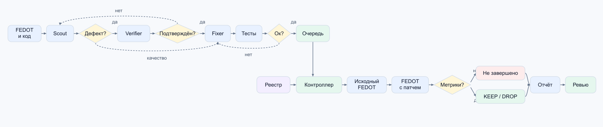

# ML System Design Doc: EvolveAgent для FEDOT

Документ описывает архитектуру EvolveAgent в FEDOT.LLM и план её проверки.

Структура из [шаблона Reliable ML](https://github.com/IrinaGoloshchapova/ml_system_design_doc_ru/blob/main/ML_System_Design_Doc_Template.md) под требования [домашнего задания](https://gist.github.com/pacifikus/47424379293e0874859354ecd130ba13) и задачу автоматического улучшения кода.

## 1. Цели и предпосылки

### 1.1. Зачем идём в разработку продукта?

FEDOT автоматически строит ML-пайплайны, но развитие самой библиотеки требует ручной работы: разработчик изучает код, формулирует гипотезу, пишет изменение и проверяет его на разных задачах. Исправление, полезное для одного датасета, может ухудшить результат на другом.

**Цель EvolveAgent** — сократить ручной перебор гипотез и подготовку патчей, сохранив проверяемость результата. Разработчик получает предложенное улучшение, объяснение механизма и результаты сравнения, на основании которых может принять решение о включении изменения в FEDOT.

**Почему станет лучше:** система поможет быстрее находить улучшения в коде с помощью LLM и экономить время на исследование. LLM подходит для поиска нетривиальных связей между кодом, контрактами функций и возможными изменениями. Линтеры и обычные тесты полезны как технические фильтры, но сами по себе не создают гипотезы улучшения AutoML. Поэтому система сочетает LLM для поиска с программным контроллером для независимой оценки.

**Успех итерации с точки зрения пользователя:** полный воспроизводимый цикл от исходников до отчёта и хотя бы одно предложенное улучшение, прошедшее заранее зафиксированные критерии качества и ручное ревью.

### 1.2. Бизнес-требования и ограничения

#### Краткое описание бизнес-требований

Нужен патч FEDOT, объяснение механизма и сравнение с исходной версией на одних и тех же задачах. Решение о включении в библиотеку принимает человек. Отдельного документа Product Owner нет: требования этой итерации записаны здесь.

#### Функциональные требования

1. По фиксированной версии FEDOT система сама выбирает место изменения и предлагает патч.
2. Гипотезу о дефекте она пытается воспроизвести; гипотезу о качестве проверяет экспериментом.
3. Патч проходит технические проверки до дорогого ML-запуска.
4. Исходная и изменённая версии сравниваются на одинаковых данных, разбиении, seed и ресурсах.
5. Пользователь получает метрики, ошибки и итог проверки. Влить изменение в FEDOT может только он.

#### Бизнес-ограничения

- LLM не видит финальные метрики и эталонные патчи. Модель одна: `z-ai/glm-5.3-flash`, без fallback и без обучения своей LLM.
- 4 CPU на задачу, до 7 пар датасетов. Бюджет FEDOT — 4500 секунд после слота, предел стороны — 5400 секунд, аварийный watchdog — 10800 секунд..
- Нет метрики, timeout или сбой — это не `KEEP` и не доказанное ухудшение качества.

#### Что мы ожидаем от конкретной итерации

Полный цикл от исходников FEDOT до отчёта. Роста качества AutoML.

#### Описание бизнес-процесса пилота

Сейчас разработчик сам ищет гипотезу, пишет патч и проверяет его. В пилоте это делает EvolveAgent, а человек остаётся на ревью. Исследователь задаёт версию и бюджеты, агент предлагает патч, контроллер сравнивает исходный FEDOT и версию с патчем. После ревью изменение можно оформить pull request в FEDOT. Модель сама ничего не вливает.

#### Что считаем успешным пилотом

- Хотя бы одно улучшение получило `KEEP` и прошло ручное ревью.
- У каждого предложения есть результат проверки или явная причина, почему её нет.
- Для `KEEP` сохранены парные метрики, патч, версии и журналы. Ошибки и таймауты не записаны как метрики.

Пути развития: разобрать отказы, проверить устойчивость на других seed и датасетах, посчитать стоимость одного принятого изменения. Публичный сервис — только после этого.

### 1.3. Что входит в скоуп проекта/итерации, что не входит

**Входит:** поиск патчей FEDOT через Scout, Verifier и Fixer; техническая проверка; сравнение качества с исходным FEDOT; очередь, лимиты и отчёт для ревью.

**Не входит:** своя LLM, автоматический merge FEDOT, другие репозитории, доказательство улучшения на всех датасетах.

### 1.4. Предпосылки решения

Патч имеет смысл только для зафиксированной версии FEDOT. Общий код проверяем широко, потому что он влияет на несколько классов задач. Дорогой AutoML-поиск запускаем только после применимости патча, импорта и коротких тестов. Готовая LLM и текущий механизм обучения FEDOT уже есть; задача итерации — организовать поиск изменений и честную проверку эффекта.
дава
## 2. Методология

### 2.1. Постановка задачи

На входе версия FEDOT, описание кода и протокол проверки. На выходе патч, объяснение и результат сравнения. LLM предлагает изменение, FEDOT обучает пайплайны, контроллер смотрит, стало ли качество лучше без регрессий. Классификация, регрессия и прогнозы — это задачи проверки FEDOT, а не отдельная модель агента. Своей обучающей выборки у агента нет.

### 2.2. Блок-схема решения

Схема повторяется для каждого датасета. Пары идут параллельно в общем лимите. Финальные метрики агенту не возвращаются.

### 2.3. Данные и подготовка проверки

Агент видит код FEDOT и то, какие функции реально исполнились. Финальные метрики ему не отдают.

В реестре 40 задач: 24 классификации OpenML, 8 регрессий OpenML-CTR23 и 8 временных рядов (`beer`, `australia`, `salaries`, `temperature`, `traffic`, `economic`, `arctic`, `metocean`). Для OpenML берётся `repeat=0`, `fold=0`. У рядов holdout — хвост, без подглядывания в будущее. Общий код проверяется на всём наборе. Состав и пороги лежат в [`quality_registry.json`](../fedotllm/agents/evolve/evaluation/quality_registry.json).

### 2.4. Бейзлайн и основное решение

Бейзлайн качества — исходный FEDOT, `Fedot(best_quality)` с tuning, на тех же данных и бюджете. Scout ищет место, Verifier проверяет дефект, Fixer пишет патч, Judge измеряет качество. Новые падения тестов не допускаются. Экономию времени человека ещё предстоит измерить отдельно от времени эксперимента.

### 2.5. Метрики и правило принятия улучшения

- классификация — ROC-AUC, больше лучше, порог улучшения 0.01;
- регрессия — RMSE, меньше лучше, порог 1%;
- временные ряды — MAE, меньше лучше, порог 1% или абсолютный порог из реестра.

`KEEP` возможен, только если обе стороны на всех нужных датасетах дали валидную метрику, регрессий нет и порог взят больше чем на половине датасетов или минимум на двух. Иначе `DROP`. Правило — [`decision_from_quality_jobs`](../fedotllm/agents/evolve/evaluation/fedot_quality.py). Один seed делает запуск сравнимым, но не доказывает значимость.

## 3. Подготовка пилота

### 3.1. Способ оценки пилота

До метрик фиксируем версии, модель, реестр и бюджеты. Сохраняем все предложения, не только удачные. Патч после финальных метрик не подгоняем. Отчёт включает пропуски, расходы и время человека. `KEEP` ещё раз смотрит человек.

### 3.2. Что считаем успешным пилотом

Критерии те же, что в разделе 1.2: есть проверенный `KEEP`, у остальных предложений явный статус, артефакты сохранены, таймаут не выдан за метрику.

### 3.3. Риски и меры

- Ошибка LLM отсекается воспроизведением, минимальным патчем и ревью.
- Улучшение на одной задаче и регрессия на другой запрещают `KEEP`.
- Подстройку под оценку снимает разделение поиска и Judge.
- Шум AutoML проверяем повторным seed, долгий fit и сбои — лимитами и отдельными статусами ошибок.
- Сгенерированный код исполняется в отдельной среде с ограниченными правами.

## 4. Эксплуатация MVP и дальнейшее развитие

MVP входит в `fedotllm`: контроллер в `controller/`, проверка в `evaluation/`, агенты в `agents/` и `discovery/`, запуск в `execution/`, состояние в `storage/`. Каждый запуск пишет очередь, патчи и журналы в свой каталог. Старый результат переиспользуется только при тех же коде, данных и протоколе. Heartbeat показывает, что наблюдатель жив; продвижение обучения видно по новым результатам датасетов.

## 5. Открытые вопросы

- Какой объём кампании и бюджет LLM достаточны для пилота?
- Как сопоставить сложность ручных и агентных задач при измерении времени?
- Какие дополнительные датасеты и seed использовать для независимого подтверждения?
- Какая доля незавершённых проверок допустима для практического использования?
- Какие требования к изоляции и раскрытию исходников нужны для внешних пользователей?

