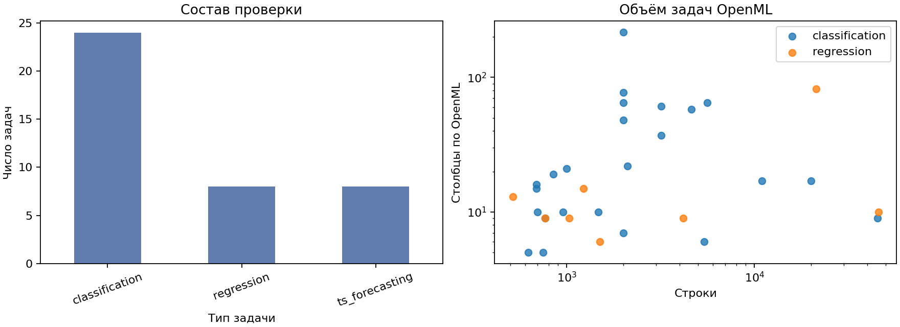
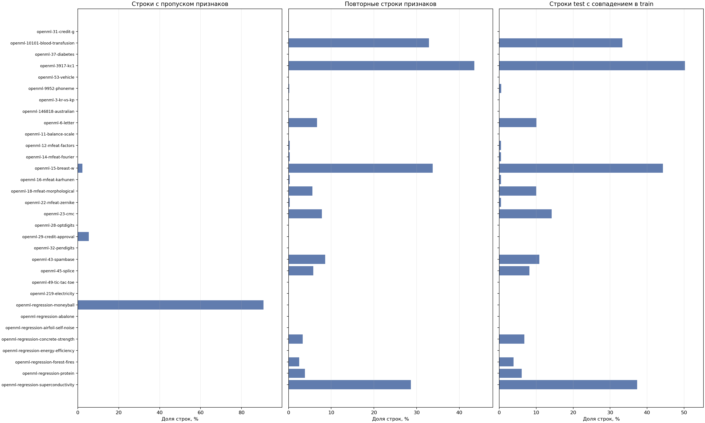
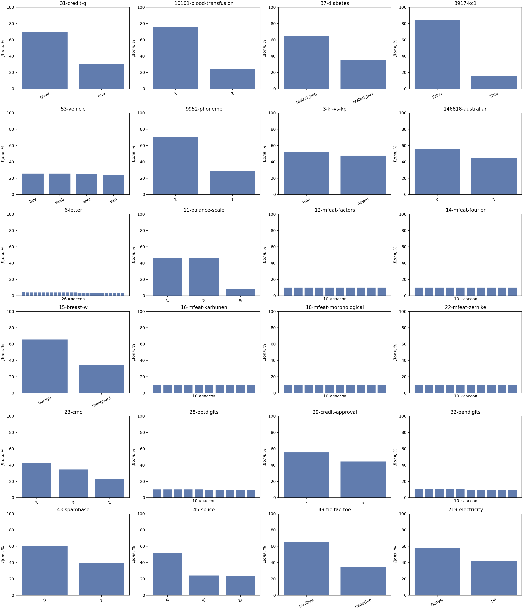
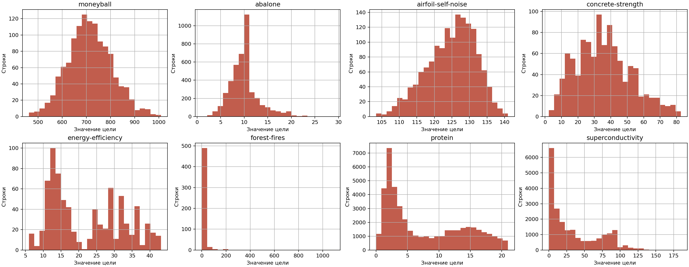

# EDA датасетов проверки EvolveAgent

Анализ выполнен 14 ноября 2026 года для зафиксированного набора из
[`quality_registry.json`](../evaluation/quality_registry.json). Это анализ входных
датасетов проверки, а не результат обучения FEDOT. Код анализа, выполненные ячейки
и графики — в [ноутбуке](eda.ipynb). Он создаёт сводные таблицы
[`task_inventory.csv`](eda_assets/task_inventory.csv) и
[`raw_audit.csv`](eda_assets/raw_audit.csv) из исходных источников.

## Источники и метод

- Для 32 задач OpenML использованы опубликованные метаданные
  `NumberOfInstances`, `NumberOfFeatures`, `NumberOfMissingValues` и размеры
  классов. Их снимок и ссылки на API сохранены в
  [`openml_qualities.json`](eda_assets/openml_qualities.json). Это показатели OpenML для
  полных датасетов, которые отдельно сверены с сырыми таблицами.
- Три ряда взяты из `FEDOT/examples/data/ts`, ещё пять — из
  `FEDOT/examples/real_cases/data`. Считаны целевые столбцы из реестра; SHA-256
  каждого CSV совпал с записью реестра. Пропуски в рядах измерены до удаления
  некорректных значений.
- Для всех 32 задач OpenML прочитаны сырые таблицы и индексы официального
  `repeat=0, fold=0`. Подсчитаны пропуски, повторы строк признаков и совпадения
  признаков между train и test. Для каждой задачи построено распределение цели.
  Результаты по задачам сохранены в [`raw_audit.csv`](eda_assets/raw_audit.csv),
  численность каждого класса — в [`class_balance.csv`](eda_assets/class_balance.csv).
- В репозиторий добавлены только метаданные, сводная таблица и графики. Сырые
  датасеты остаются в публичных источниках и локальном кэше.

Для повторного анализа откройте [ноутбук](eda.ipynb) из его каталога и
выполните ячейки сверху вниз. Перед запуском задайте переменную окружения
`FEDOT_CHECKOUT=/absolute/path/to/FEDOT`. Нужны `pandas`, `numpy`,
`matplotlib` и `openml`; таблицы OpenML должны быть доступны по сети
или в локальном кэше. Ячейки пересоздают CSV и PNG в `eda_assets/`.

## Состав и объём

Набор содержит 40 задач: 24 классификации, 8 регрессии и 8 прогнозирования
временных рядов. Из них 32 задачи используют OpenML, восемь — примеры FEDOT.
По метаданным OpenML размеры таблиц варьируются от 517 до 45 730 строк и от
5 до 217 столбцов. `NumberOfFeatures` взят как опубликованное свойство OpenML;
его не следует автоматически трактовать как число признаков после удаления
целевого столбца и предобработки. Из-за различий масштаба задача на одном
датасете не заменяет проверку на всём наборе.

## Качество и риски

OpenML сообщает пропуски в трёх из 32 таблиц: Moneyball — 19,48%,
credit-approval — 0,61%, breast-w — 0,23%. Пропуски могут влиять на выбор
операций предобработки FEDOT и на результат патча. Опубликованная доля пропущенных
ячеек и показанная на графике доля строк с пропусками — разные показатели.

Проверка всех 32 сырых таблиц подтвердила пропуски в признаках трёх задач;
пропусков цели не найдено. В 17 задачах есть повторяющиеся строки признаков.
В тех же 17 задачах как минимум одна строка test совпадает по признакам со
строкой train. Наибольшие абсолютные числа таких строк: `Superconductivity` — 794,
`Physicochemical Protein` — 278, `letter` — 201. Это риск завышенной оценки
качества на данном разбиении. Совпадение признаков само по себе не доказывает
утечку цели: разным наблюдениям могут соответствовать одинаковые признаки.
Перед оценкой нового патча нужно отдельно разобрать задачи с повторами и
проверить, меняют ли они итоговое решение.

## Целевые переменные

Для всех 24 задач классификации построены доли классов. Число классов варьируется
от 2 до 26; наименьшая доля отдельного класса — 3,67% в `letter`. Для задач с
многими классами точные названия и числа строк есть в
[`class_balance.csv`](eda_assets/class_balance.csv). Дисбаланс нужно учитывать
при интерпретации метрик каждого датасета.

Для всех восьми задач регрессии построены распределения цели. Их масштабы и
формы различаются: например, у `forest-fires` большая часть значений близка к
нулю, а у `protein` видны два скопления. Минимум, квартиль 25%, медиана,
квартиль 75% и максимум по каждой задаче приведены в
[`raw_audit.csv`](eda_assets/raw_audit.csv). Сравнивать абсолютные значения целей
между разными задачами напрямую нельзя.

Длины рядов — от 204 до 17 520 строк; в выбранных целевых столбцах нет
нечисловых или пропущенных значений. Красным выделены последние 12–24 точки,
которые протокол оставляет для прогноза. У рядов заметны разный масштаб,
тренды, сезонные колебания и отдельные всплески. Поэтому случайное перемешивание
строк для них недопустимо; проверка использует хронологическое разделение.

## Границы анализа

Метаданные OpenML описывают исходные датасеты. Аудит сырых таблиц проверил
официальный `repeat=0, fold=0` и точные совпадения признаков между его частями.
Причины повторов, качество разметки и содержательную утечку признаков этот
автоматический подсчёт не устанавливает; их нужно разбирать по описаниям задач
и конкретным столбцам. Этот EDA не доказывает, что патч улучшает качество: для этого нужен
отдельный парный прогон исходного FEDOT и версии с патчем. Публичность источника
не исключает чувствительных признаков; сырые строки не публикуются в отчёте.

## Данные для обучения поиска гипотез

Это другой набор данных: одна строка на гипотезу Scout с версией кода, контекстом,
трассой, последующими проверками и отзывом ревьювера. Его нельзя заменить 40
датасетами проверки FEDOT. Сейчас журналы содержат разрозненные записи, но
очищенный размеченный набор не сформирован; статистику о числе удачных гипотез
поэтому не приводим. Схема будущего набора и правило оценки агента описаны в
[дизайн-документе](ml_system_design_doc.md). Дообучение относится к будущей
итерации; в этом ДЗ его результаты не заявлены.
