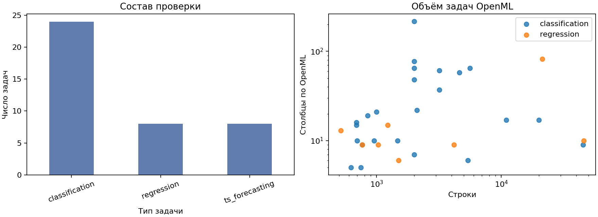
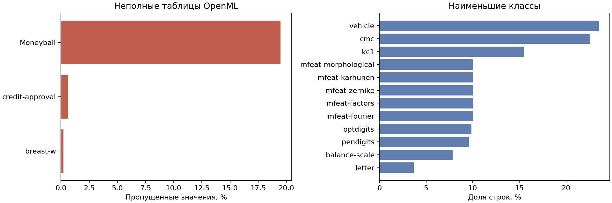
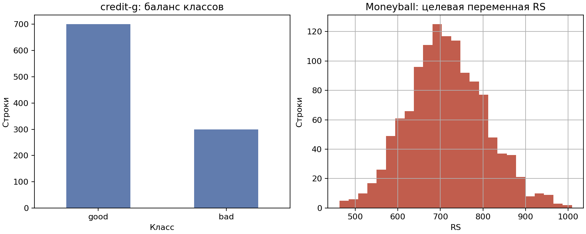
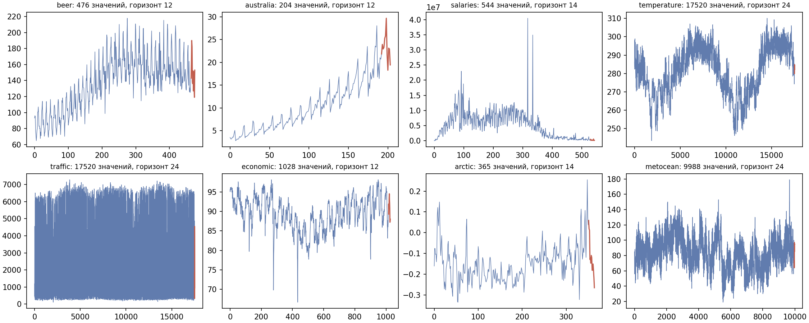

# EDA датасетов проверки EvolveAgent

Анализ выполнен 14 ноября 2026 года для зафиксированного набора из
[`quality_registry.json`](../../evaluation/quality_registry.json). Это анализ входных
датасетов проверки, а не результат обучения FEDOT. Таблица по каждой задаче —
[`task_inventory.csv`](task_inventory.csv); код построения таблицы и графиков —
[`research/evolve/hw2_eda.py`](../../../../../research/evolve/hw2_eda.py).
Шаги анализа с выполненными ячейками и графиками — в [ноутбуке](eda.ipynb).

## Источники и метод

- Для 32 задач OpenML использованы опубликованные метаданные
  `NumberOfInstances`, `NumberOfFeatures`, `NumberOfMissingValues` и размеры
  классов. Их снимок и ссылки на API сохранены в
  [`openml_qualities.json`](openml_qualities.json). Это показатели OpenML для
  полных датасетов; сырые таблицы и конкретные train/test части здесь не
  перечитывались.
- Три ряда взяты из `FEDOT/examples/data/ts`, ещё пять — из
  `FEDOT/examples/real_cases/data`. Считаны целевые столбцы из реестра; SHA-256
  каждого CSV совпал с записью реестра. Пропуски в рядах измерены до удаления
  некорректных значений.
- Сырые таблицы `credit-g` и `Moneyball` прочитаны из OpenML для проверки
  распределения цели и пропусков. Сохранены только агрегаты
  [`raw_samples.json`](raw_samples.json), без строк исходных данных.
- В репозиторий добавлены только метаданные, сводная таблица и графики. Сырые
  датасеты остаются в публичных источниках и локальном кэше.

Повторить анализ при наличии FEDOT checkout:

```bash
python research/evolve/hw2_eda.py --fedot-checkout /absolute/path/to/FEDOT --raw-samples
```

Для повторного выполнения ноутбука задайте переменную окружения
`FEDOT_CHECKOUT=/absolute/path/to/FEDOT`. Нужны `pandas`, `numpy`,
`matplotlib` и `openml`; две сырые таблицы OpenML должны быть доступны по сети
или в локальном кэше.

## Состав и объём



Набор содержит 40 задач: 24 классификации, 8 регрессии и 8 прогнозирования
временных рядов. Из них 32 задачи используют OpenML, восемь — примеры FEDOT.
По метаданным OpenML размеры таблиц варьируются от 517 до 45 730 строк и от
5 до 217 столбцов. `NumberOfFeatures` взят как опубликованное свойство OpenML;
его не следует автоматически трактовать как число признаков после удаления
целевого столбца и предобработки. Из-за различий масштаба задача на одном
датасете не заменяет проверку на всём наборе.

## Качество и риски



OpenML сообщает пропуски в трёх из 32 таблиц: Moneyball — 19,48%,
credit-approval — 0,61%, breast-w — 0,23%. Пропуски могут влиять на выбор
операций предобработки FEDOT и на результат патча. Наименьший класс в `letter`
составляет 3,67% строк; для таких задач важно смотреть метрики по отдельным
датасетам, а не только общий исход проверки. Качество разметки и утечки
признаков по одним метаданным определить нельзя — для этого нужен отдельный
анализ сырых таблиц и описаний задач.



В проверенном `credit-g` 1000 строк, 20 входных признаков и классы 700/300;
пропусков в прочитанной таблице нет. В `Moneyball` 1232 строки, 14 входных
признаков и 3600 пропущенных ячеек признаков; целевая переменная `RS` не имеет
пропусков, медиана — 711, диапазон — 463–1009. Это подтверждает, что
предобработка пропусков нужна как минимум для части регрессионных задач.



Длины рядов — от 204 до 17 520 строк; в выбранных целевых столбцах нет
нечисловых или пропущенных значений. Красным выделены последние 12–24 точки,
которые протокол оставляет для прогноза. У рядов заметны разный масштаб,
тренды, сезонные колебания и отдельные всплески. Поэтому случайное перемешивание
строк для них недопустимо; проверка использует хронологическое разделение.

## Границы анализа

Метаданные OpenML описывают исходные датасеты, а не конкретный `repeat=0,
fold=0`. Сырые строки проверены только для двух примеров; для полного аудита ещё
нужно загрузить остальные 30 таблиц и проверить
пропуски, дубликаты, распределение цели и возможную утечку отдельно в train и
test. Этот EDA не доказывает, что патч улучшает качество: для этого нужен
отдельный парный прогон исходного FEDOT и версии с патчем. Публичность источника
не исключает чувствительных признаков; сырые строки не публикуются в отчёте.

## Данные для обучения поиска гипотез

Это другой набор данных: одна строка на гипотезу Scout с версией кода, контекстом,
трассой, последующими проверками и отзывом ревьювера. Его нельзя заменить 40
датасетами проверки FEDOT. Сейчас журналы содержат разрозненные записи, но
очищенный размеченный набор не сформирован; статистику о числе удачных гипотез
поэтому не приводим. Схема будущего набора и правило оценки агента описаны в
[дизайн-документе](../ml_system_design_doc.md). Дообучение относится к будущей
итерации; в этом ДЗ его результаты не заявлены.
