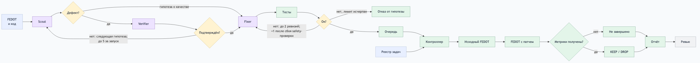

# ML System Design Doc: EvolveAgent для FEDOT

Документ описывает архитектуру EvolveAgent в FEDOT.LLM и план её проверки.

Структура из [шаблона Reliable ML](https://github.com/IrinaGoloshchapova/ml_system_design_doc_ru/blob/main/ML_System_Design_Doc_Template.md) под требования [домашнего задания](https://gist.github.com/pacifikus/47424379293e0874859354ecd130ba13) и задачу автоматического улучшения кода.

## 1. Цели и предпосылки

### 1.1. Зачем идём в разработку продукта?

FEDOT автоматически строит ML-пайплайны, но развитие самой библиотеки требует ручной работы: разработчик изучает код, формулирует гипотезу, пишет изменение и проверяет его на разных задачах. Исправление, полезное для одного датасета, может ухудшить результат на другом.

**Цель EvolveAgent** — сократить ручной перебор гипотез и подготовку патчей, сохранив проверяемость результата. Разработчик получает предложенное улучшение, объяснение механизма и результаты сравнения, на основании которых может принять решение о включении изменения в FEDOT.

**Почему станет лучше:** система поможет быстрее находить улучшения в коде с помощью LLM и экономить время на исследование. LLM подходит для поиска нетривиальных связей между кодом, контрактами функций и возможными изменениями. Линтеры и обычные тесты полезны как технические фильтры, но сами по себе не создают гипотезы улучшения AutoML. Поэтому система сочетает LLM для поиска с программным контроллером для независимой оценки.

**Альтернативы для поиска изменений:**

- Ручная разработка: ориентир по времени человека и числу принятых патчей.
- Универсальный кодинг-агент, например Codex или SWE-agent: та же задача без специальных ролей Scout, Verifier и Fixer.
- Эволюционный поиск кода в духе AlphaEvolve или OpenEvolve: несколько поколений предложенных патчей.

Для сравнения нужны одинаковая версия FEDOT, список задач, лимит времени и вычислений, независимая проверка качества и ручное ревью. Сравниваем число принятых изменений и затраты на одно изменение. Эти сравнения ещё не проведены, поэтому преимущество EvolveAgent перед альтернативами пока гипотеза.

**Успех итерации с точки зрения пользователя:** полный воспроизводимый цикл от исходников до отчёта и хотя бы одно предложенное улучшение, прошедшее заранее зафиксированные критерии качества и ручное ревью.

### 1.2. Бизнес-требования и ограничения

#### Краткое описание бизнес-требований

Нужен патч FEDOT, объяснение механизма и сравнение с исходной версией на одних и тех же задачах. Решение о включении в библиотеку принимает человек. Отдельного документа Product Owner нет: требования этой итерации записаны здесь.

#### Функциональные требования

1. По фиксированной версии FEDOT система сама выбирает место изменения и предлагает патч.
2. Гипотезу о дефекте она пытается воспроизвести; гипотезу о качестве проверяет экспериментом.
3. Патч проходит технические проверки до дорогого ML-запуска.
4. Исходная и изменённая версии сравниваются на одинаковых данных, разбиении, seed и ресурсах.
5. Пользователь получает метрики, ошибки и итог проверки. Влить изменение в FEDOT может только он.

#### Бизнес-ограничения

- LLM не видит финальные метрики и эталонные патчи. Модель одна: `z-ai/glm-5.3-flash`, без fallback и без обучения своей LLM.
- 4 CPU на задачу, до 7 пар датасетов. Бюджет FEDOT — 4500 секунд после слота, предел стороны — 5400 секунд, аварийный watchdog — 10800 секунд.
- Нет метрики, timeout или сбой — это не `KEEP` и не доказанное ухудшение качества.

#### Срок и бюджет пилота

План пилота: не более 10 предложенных улучшений за 7 суток, с лимитом $10 на поиск через LLM. Вычисления ограничены указанными выше лимитами параллелизма и времени каждой стороны; суммарные CPU-часы и фактические расходы записываются в отчёт. На ручной просмотр и разбор результатов закладываем не более 8 часов разработчика, время фиксируем по каждому предложению. Если любой лимит исчерпан раньше, поиск новых предложений останавливается. Лимит ручного времени контроллер автоматически не обеспечивает: за ним следит ответственный за пилот.

#### Что мы ожидаем от конкретной итерации

В этой итерации агент предлагает патчи, а контроллер сравнивает FEDOT до и после каждого изменения. Цель — найти хотя бы один патч, который улучшает качество на датасетах проверки и проходит ручное ревью. Если такого патча нет, отчёт покажет результаты и причины отказа для каждого предложения.

#### Описание бизнес-процесса пилота

Сейчас разработчик сам ищет гипотезу, пишет патч и проверяет его. В пилоте это делает EvolveAgent, а человек остаётся на ревью. Исследователь задаёт версию и бюджеты, агент предлагает патч, контроллер сравнивает исходный FEDOT и версию с патчем. После ревью изменение можно оформить pull request в FEDOT. Модель сама ничего не вливает.

#### Что считаем успешным пилотом

- Хотя бы одно из не более 10 предложенных улучшений получило `KEEP` и прошло ручное ревью.
- У каждого предложения есть результат проверки или явная причина, почему её нет.
- Для `KEEP` сохранены парные метрики, патч, версии и журналы. Ошибки и таймауты не записаны как метрики.

В отчёте отдельно указываем число всех предложений, число завершённых проверок, число `KEEP` после ревью, долю `KEEP`, затраты LLM и вычислений, а также часы разработчика на одно принятое изменение. Если к сроку или лимиту предложений нет принятого изменения, пилот завершается как неуспешный; причины отказов и незавершённых проверок остаются в отчёте. При нуле принятых изменений стоимость одного принятого изменения не вычисляем, а показываем общие затраты.

Пути развития: разобрать отказы, проверить устойчивость на других seed и датасетах, посчитать стоимость одного принятого изменения. Публичный сервис — только после этого.

### 1.3. Что входит в скоуп проекта/итерации, что не входит

**Входит:** поиск патчей FEDOT через Scout, Verifier и Fixer; техническая проверка; сравнение качества с исходным FEDOT; очередь, лимиты и отчёт для ревью.

**Не входит:** своя LLM, автоматический merge FEDOT, другие репозитории, доказательство улучшения на всех датасетах.

### 1.4. Предпосылки решения

Патч имеет смысл только для зафиксированной версии FEDOT. Общий код проверяем широко, потому что он влияет на несколько классов задач. Дорогой AutoML-поиск запускаем только после применимости патча, импорта и коротких тестов. Готовая LLM и текущий механизм обучения FEDOT уже есть; задача итерации — организовать поиск изменений и честную проверку эффекта.

## 2. Методология

### 2.1. Постановка задачи

На входе версия FEDOT, описание кода и протокол проверки. На выходе патч, объяснение и результат сравнения. LLM предлагает изменение, FEDOT обучает пайплайны, контроллер смотрит, стало ли качество лучше без регрессий. Классификация, регрессия и прогнозы — это задачи проверки FEDOT, а не отдельная модель агента. Своей обучающей выборки у агента нет.

### 2.2. Блок-схема решения

Фиолетовые блоки — LLM-агенты Scout, Verifier и Fixer. Зелёные блоки — шаги, которые выполняет код. Judge из раздела 2.4 — часть контроллера: он оценивает результат парного сравнения и принимает решение по метрикам.

Если Verifier не подтвердил дефект, контроллер отклоняет эту гипотезу и берёт следующую. За запуск он отбирает не более `max_hypotheses` гипотез (по умолчанию 5). Для Scout выделено до половины `max_actions` (по умолчанию 15 из 30 действий); общий лимит действий и бюджет кампании также ограничивают поиск. Fixer делает не более `max_revisions` ревизий патча (по умолчанию 2), плюс одну адресную ревизию только после сбоя проверки безопасности. После исчерпания лимита гипотеза отклоняется. Парные запуски повторяются для каждого требуемого датасета в общем лимите параллелизма. Финальные метрики агенту не возвращаются.

### 2.3. Данные и подготовка проверки

Агент видит код FEDOT и то, какие функции реально исполнились. Финальные метрики ему не отдают.

В реестре 40 задач: 20 классификаций из [OpenML-CC18](https://www.openml.org/search?id=99&type=study), ещё 4 задачи классификации OpenML, 8 регрессий из [OpenML-CTR23](https://www.openml.org/search?id=353&type=study) и 8 временных рядов FEDOT (`beer`, `australia`, `salaries`, `temperature`, `traffic`, `economic`, `arctic`, `metocean`). Для OpenML берётся `repeat=0`, `fold=0`. У рядов holdout — хвост, без подглядывания в будущее. Общий код проверяется на всём наборе. Точные идентификаторы задач, пути, контрольные суммы и пороги лежат в [`quality_registry.json`](../evaluation/quality_registry.json).

Данные берутся из OpenML и [публичных примеров FEDOT](https://github.com/aimclub/FEDOT/tree/master/examples/data/ts). Пять рядов из [real_cases FEDOT](https://github.com/aimclub/FEDOT/tree/master/examples/real_cases/data) читаются из отдельного checkout или подготовленного кэша; их контрольные суммы проверяются перед запуском. Большие копии датасетов в FEDOT.LLM не добавляются: для воспроизведения нужны указанные источники и зафиксированные в реестре версии данных.

### 2.4. Бейзлайн и основное решение

Бейзлайн качества модели — исходный FEDOT, `Fedot(best_quality)` с tuning, на тех же данных и бюджете. Для поиска патчей бейзлайны перечислены в разделе 1.1; исходный FEDOT сам по себе таким бейзлайном не является. Scout ищет место, Verifier проверяет дефект, Fixer пишет патч, Judge измеряет качество. Новые падения тестов не допускаются. Экономию времени человека ещё предстоит измерить отдельно от времени эксперимента.

### 2.5. Метрики и правило принятия улучшения

- классификация — ROC-AUC, больше лучше, порог улучшения 0.01;
- регрессия — RMSE, меньше лучше, порог 1%;
- временные ряды — MAE, меньше лучше, порог 1% или абсолютный порог из реестра.

Результат проверки имеет три исхода:

| Исход | Условие |
|---|---|
| `KEEP` | Все требуемые пары дали валидные метрики, регрессий нет; порог улучшения достигнут строго больше чем на половине требуемых датасетов. Для полного набора из 40 задач нужно минимум 21 улучшение. |
| `DROP` | Все требуемые пары оценены, но есть регрессия или улучшений недостаточно. |
| `not_evaluated` | Хотя бы одна требуемая пара не дала валидной метрики: пропущенный датасет, таймаут, ошибка запуска или проверки. Это не свидетельство ухудшения качества. |

Правило реализовано в [`decision_from_quality_jobs`](../evaluation/fedot_quality.py). Один seed делает парный запуск сравнимым, но не доказывает значимость улучшения. Перед выводом об устойчивом росте качества нужен A/A-прогон исходного FEDOT с разными seed на том же наборе: он покажет, сколько улучшений возникает без патча, и позволит заранее откалибровать пороги. Пока такой калибровки нет, `KEEP` означает прохождение заданного правила, а не статистическое доказательство эффекта.

## 3. Подготовка пилота

### 3.1. Способ оценки пилота

До метрик фиксируем версии, модель, реестр и бюджеты. Сохраняем все предложения, не только удачные. Патч после финальных метрик не подгоняем. Отчёт включает пропуски, расходы и время человека. `KEEP` ещё раз смотрит человек.

### 3.2. Что считаем успешным пилотом

Критерии те же, что в разделе 1.2: для ограниченного числа предложений указан знаменатель и есть проверенный `KEEP`; у остальных предложений явный статус, артефакты сохранены, таймаут даёт `not_evaluated`, а не метрику или `DROP`. По достижении срока или лимита предложений без принятого изменения пилот останавливается с отрицательным результатом.

### 3.3. Риски и меры

- Ошибка LLM отсекается воспроизведением, минимальным патчем и ревью.
- Улучшение на одной задаче и регрессия на другой запрещают `KEEP`.
- Подстройку под оценку снимает разделение поиска и Judge.
- Шум AutoML проверяем повторным seed, долгий fit и сбои — лимитами и отдельными статусами ошибок.
- Сгенерированный код исполняется в отдельной среде с ограниченными правами.

## 4. Эксплуатация MVP и дальнейшее развитие

MVP входит в `fedotllm`: контроллер в `controller/`, проверка в `evaluation/`, агенты в `agents/` и `discovery/`, запуск в `execution/`, состояние в `storage/`. Каждый запуск пишет очередь, патчи и журналы в свой каталог. Старый результат переиспользуется только при тех же коде, данных и протоколе. Heartbeat показывает, что наблюдатель жив; продвижение обучения видно по новым результатам датасетов.

## 5. Открытые вопросы

- Какой объём кампании и бюджет LLM достаточны для пилота?
- Как сопоставить сложность ручных и агентных задач при измерении времени?
- Какие дополнительные датасеты и seed использовать для независимого подтверждения?
- Какая доля незавершённых проверок допустима для практического использования?
- Какие требования к изоляции и раскрытию исходников нужны для внешних пользователей?

