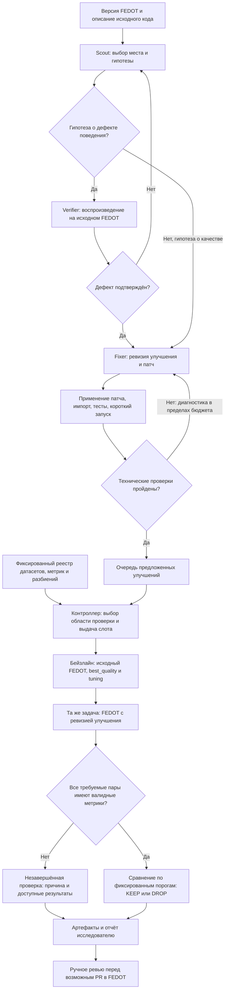

# ML System Design Doc: EvolveAgent для FEDOT

**Автор:** Кирилл Анпилов

**Дата:** 29.10.2026

**Итерация:** исследовательский MVP, домашнее задание №1 по ML System Design.

**Продукт:** агент поиска и проверки улучшений исходного кода библиотеки AutoML FEDOT.

Документ описывает существующую архитектуру EvolveAgent в FEDOT.LLM и план
её проверки в пилоте. Критерии успеха ниже — цели пилота, а не заявление
о достигнутом улучшении качества или экономии времени.

Структура адаптирована из [шаблона Reliable ML](https://github.com/IrinaGoloshchapova/ml_system_design_doc_ru/blob/main/ML_System_Design_Doc_Template.md)
под требования домашнего задания и задачу автоматического улучшения кода.

## Термины

- **Предложенное улучшение (`proposal`)** — гипотеза об изменении FEDOT вместе с патчем и ожидаемым эффектом.
- **Ревизия улучшения** — конкретная версия гипотезы и патча, связанная с исходной версией FEDOT.
- **Проверка улучшения** — сравнение исходного FEDOT и версии с предложенным улучшением на заранее выбранных датасетах.
- **Датасеты проверки** — датасеты классификации, регрессии и прогнозирования временных рядов из фиксированного реестра.
- **Результат проверки** — метрики и решение сохранить (`KEEP`) или отклонить (`DROP`) улучшение либо явная причина незавершённой проверки.
- **Описание исходного кода (`source_context`)** — доступные агенту исходники, карта репозитория и сведения об исполненных функциях.

## 1. Цели и предпосылки

### 1.1. Зачем идём в разработку продукта?

FEDOT автоматически строит ML-пайплайны, но развитие самой библиотеки требует
ручной работы: разработчик изучает код, формулирует гипотезу, пишет изменение
и проверяет его на разных задачах. Исправление, полезное для одного датасета,
может ухудшить результат на другом. Локальный успешный тест не подтверждает
улучшение качества AutoML.

Цель EvolveAgent — сократить ручной перебор гипотез и подготовку патчей,
сохранив проверяемость результата. Разработчик получает предложенное улучшение,
объяснение механизма и результаты сравнения, на основании которых может
принять решение о включении изменения в FEDOT.

**Пользователи:** разработчики и исследователи FEDOT. Заинтересованные стороны —
сопровождающие библиотеки и исследовательская команда; ментор и студенты курса
оценивают учебный результат проекта.

LLM подходит для поиска нетривиальных связей между кодом, контрактами функций
и возможными изменениями. Линтеры и обычные тесты полезны как технические фильтры,
но сами по себе не создают гипотезы улучшения AutoML. Поэтому система сочетает
LLM для поиска с программным контроллером для независимой оценки.

**Успех итерации с точки зрения пользователя:** полный воспроизводимый цикл
от исходников до отчёта и хотя бы одно предложенное улучшение, прошедшее
заранее зафиксированные критерии качества и ручное ревью. Если таких улучшений
нет, это отрицательный исследовательский результат; он не заменяется количеством
сгенерированных патчей. Экономию времени потребуется измерить отдельно.

### 1.2. Бизнес-требования и ограничения

#### Функциональные требования

1. Система принимает фиксированную версию FEDOT и описание исходного кода,
   самостоятельно выбирает место изменения и формирует предложенное улучшение.
2. Для гипотез о дефекте поведения система пытается получить воспроизводящий
   пример на исходной версии. Гипотезы о качестве оцениваются экспериментально.
3. Каждая ревизия улучшения сохраняется как отдельный патч с объяснением
   и проходит технические проверки до дорогостоящего ML-эксперимента.
4. Контроллер сравнивает исходную и изменённую версии на одинаковых данных,
   разбиениях, seed и ресурсных настройках.
5. По итогам пользователь получает метрики каждой стороны по датасетам,
   причины ошибок и итоговый результат проверки.
6. Повторный запуск восстанавливает очередь и использует совместимые завершённые
   результаты, сохраняя историю попыток.
7. Принятие изменения в основную ветку FEDOT остаётся за разработчиком.

#### Ограничения

- **Независимость оценки.** LLM не получает финальные метрики, эталонные патчи
  или список известных дефектов как подсказку для поиска. Исправлять ревизию
  можно по технической диагностике; подбирать её по финальному holdout нельзя.
- **Фиксированная модель.** В текущем протоколе Scout, Verifier и Fixer используют
  `z-ai/glm-5.3-flash`. Замена модели и fallback требуют отдельного эксперимента.
  Обучение собственной LLM в эту итерацию не входит.
- **Вычислительные ресурсы.** 4 CPU на задачу, до 7 пар датасетов одновременно.
  В каждой паре исходная и изменённая стороны исполняются последовательно.
  Это до 28 настроенных CPU-слотов, а не обещание фактической загрузки CPU.
- **Время.** Бюджет FEDOT — 4500 секунд после получения вычислительного слота;
  общий предел стороны — 5400 секунд с резервом на прогноз, метрику и сохранение;
  внешний watchdog — 10800 секунд. Ожидание очереди учитывается отдельно.
- **Стоимость LLM.** До старта кампании фиксируются пределы запросов,
  стоимости одной кампании поиска и суммарной стоимости. Универсальная сумма
  и месячный бюджет пока не определены; расходы сохраняются для оценки пилота.
- **Безопасность исполнения.** Патчи проверяются в отдельных рабочих копиях
  и процессах. Основной checkout FEDOT не изменяется автоматически.
  Изоляция процесса сама по себе не гарантирует защиту от вредоносного кода.
- **Данные и секреты.** Используются датасеты фиксированного реестра; секреты,
  учётные данные и сырые датасеты не включаются в запросы к внешней LLM.
  Перед публикацией артефактов проверяются права на данные и отсутствие секретов.
- **Достоверность результата.** Отсутствующая или невалидная метрика,
  timeout и инфраструктурная ошибка сохраняются явно. Они не дают основания
  для решения `KEEP` или вывода об ухудшении ML-качества.

#### Процесс пилота

Исследователь фиксирует конфигурацию кампании, запускает поиск, получает
предложенные улучшения и передаёт их независимому контроллеру. После проверки
он изучает патч, отчёт и ограничения эксперимента. Прошедшее ревью улучшение
может быть оформлено отдельным PR в FEDOT.

### 1.3. Что входит в скоуп проекта/итерации, что не входит

**Входит:**

- поиск предложенных улучшений Python-кода FEDOT через Scout → Verifier → Fixer;
- техническая проверка патчей и короткие диагностические запуски;
- проверка ML-качества на датасетах выбранных классов задач;
- сравнение с исходным FEDOT при одинаковом протоколе;
- очередь, лимиты ресурсов и стоимости, обработка ошибок, восстановление;
- сохранение версий, патчей, конфигураций, журналов и результатов проверки;
- отчёт для ручного ревью и воспроизведения эксперимента.

**Не входит:**

- собственная фундаментальная модель, её обучение или дообучение;
- автоматический merge и выпуск новой версии FEDOT;
- улучшение произвольных репозиториев и языков программирования;
- задачи обработки изображений, аудио и другие классы вне текущего реестра;
- публичный многопользовательский сервис с SLA и платёжной системой;
- доказательство улучшения на всех возможных задачах и датасетах;
- автоматическое изменение ресурсного профиля ради завершения проверки.

**Результат итерации:** работающий исследовательский инструмент и пакет
артефактов пилота. Планируемый технический долг — более широкое покрытие
поиском composer и tuning, повторения с несколькими seed, оценка статистической
устойчивости и усиление среды исполнения перед публичным использованием.

### 1.4. Предпосылки решения

1. Исходный код FEDOT доступен, а его версия может быть зафиксирована.
   Предложенное улучшение имеет смысл только относительно этой версии.
2. Локальное изменение общего кода способно влиять на несколько классов задач.
   Поэтому область проверки определяется затронутым кодом консервативно;
   общий или неизвестный код требует широкого набора датасетов.
3. Дорогой AutoML-поиск нецелесообразно запускать для каждого сырого патча.
   Сначала проверяются применимость, импорт, тесты и короткие пайплайны.
4. Быстрый диагностический запуск помогает найти исполняемый код и ошибки,
   но не заменяет финальную проверку качества.
5. Предполагается, что фиксированный набор задач даёт полезную оценку
   переносимости изменения. Репрезентативность этого набора ограничена;
   совпадение seed также не устраняет всю недетерминированность вычислений.
6. В MVP используются готовая LLM и существующий механизм обучения FEDOT.
   Основная исследовательская задача — организовать поиск изменений
   и достоверную проверку их эффекта.

## 2. Методология

### 2.1. Постановка задачи

Технически это поиск изменений программного кода с экспериментальной оценкой.
Вход системы — версия FEDOT, описание исходного кода, ограничения поиска
и фиксированный протокол проверки. Выход — ревизия улучшения, патч,
объяснение и результат проверки.

LLM генерирует гипотезы и изменения кода. FEDOT обучает ML-пайплайны на каждом
датасете. Контроллер измеряет, улучшило ли изменение качество относительно
исходного FEDOT без ухудшения на других требуемых датасетах.

Классификация, регрессия и прогнозирование — задачи проверки FEDOT;
сам EvolveAgent не является отдельным классификатором или прогнозной моделью.
Целевые переменные и признаки определяются каждым датасетом. Специальная
размеченная обучающая выборка для агента в MVP не создаётся.

### 2.2. Блок-схема решения



Контроллер проверяет все требуемые датасеты; блок исходной и изменённой сторон
на схеме повторяется для каждого датасета. Независимые пары выполняются
параллельно в пределах общего лимита. Обратной связи от финальных метрик
к агентам поиска нет. Исчерпание бюджета прекращает цикл технических исправлений
с сохранением причины.

### 2.3. Данные и подготовка проверки

**Описание исходного кода:** файлы FEDOT, карта репозитория, вызовы и сведения
о функциях, исполненных короткими пайплайнами. Эти данные помогают выбрать
место изменения. Результаты финальной оценки агенту не передаются.

**Датасеты проверки:** реестр содержит 40 задач:

- 24 задачи классификации из OpenML, включая задачи OpenML-CC18;
- 8 задач регрессии OpenML-CTR23;
- 8 временных рядов: 3 публичных ряда FEDOT (`beer`, `australia`, `salaries`)
  и 5 рядов примеров FEDOT с фиксированными контрольными суммами
  (`temperature`, `traffic`, `economic`, `arctic`, `metocean`).

Для OpenML используются официальные разбиения `repeat=0`, `fold=0`.
Для временных рядов последние наблюдения отделяются под holdout;
горизонт зафиксирован отдельно для каждого ряда. При обучении запрещено
использовать будущие значения из holdout.

Перед пилотом проверяются доступность источников, соответствие идентификаторов
и контрольных сумм, тип целевой переменной, размеры разбиений, пропуски
и возможность вычислить метрику. Проверка загрузчика не считается успешным
обучением или подтверждением качества.

Полный набор применяется для общего и неизвестного кода. Сужение области
допускается только по установленным правилам анализа исходников. Нельзя
выбирать датасеты после просмотра результатов или только по описанию LLM.

Источник конфигурации —
[`quality_registry.json`](../../../../fedotllm/agents/evolve/evaluation/quality_registry.json).
Точный состав, горизонты, пороги и версия протокола сохраняются с запуском.

### 2.4. Бейзлайн и основное решение

**Бейзлайн ML-качества:** исходный FEDOT без предложенного улучшения,
`Fedot(best_quality)` с tuning. Для изменённой стороны совпадают данные,
разбиение, seed, CPU и временные бюджеты. Изменяется проверяемая ревизия кода.

**Основное решение:** Scout исследует код; Verifier проверяет гипотезы
о дефектах; Fixer создаёт патч. После технических фильтров независимый Judge
измеряет качество. Новые падения тестов не допускаются; существующие падения
нужно отличать от вызванных патчем.

**Бейзлайн трудозатрат для пилота:** ручная работа разработчика над сопоставимой
задачей. Планируется отдельно учитывать активное время человека на поиск,
подготовку и ревью и полное время эксперимента. Результат одного запуска агента
без ручного сравнения не доказывает экономию трудозатрат.

### 2.5. Метрики и правило принятия улучшения

Основные ML-метрики зафиксированы в реестре:

- классификация — ROC-AUC, больше лучше; минимальное улучшение — 0.01
  абсолютного значения, то есть один процентный пункт;
- регрессия — RMSE, меньше лучше; минимальное относительное снижение — 1%;
- временные ряды — MAE, меньше лучше; для пяти рядов используется снижение
  на 1%, для трёх публичных рядов — собственные абсолютные пороги в реестре.

Для каждого датасета контроллер приводит разницу к общему направлению:
положительное значение означает улучшение. Точный расчёт разницы:

```python
def quality_delta(before, after, higher_is_better, relative=False):
    difference = after - before if higher_is_better else before - after
    return difference / max(abs(before), 1e-12) if relative else difference
```

Функция сравнивает качество до и после изменения и, если нужно,
выражает выигрыш как долю от исходной метрики.

Сначала проверяется полнота: на каждом требуемом датасете обе стороны должны
завершиться с `status=ok`, конечной метрикой и `metric_valid=true`.
Пропуск, timeout или ошибка оставляют проверку незавершённой.

При полных результатах `KEEP` выдаётся, если нет ухудшений с учётом
численной погрешности и достигнут порог улучшения больше чем на половине
датасетов либо минимум на двух. Иначе выдаётся `DROP` с причиной.
Это правило реализовано в
[`decision_from_quality_jobs`](../../../../fedotllm/agents/evolve/evaluation/fedot_quality.py).

Дополнительно в пилоте измеряются число предложенных улучшений, доля технически
пригодных патчей, число полностью проверенных улучшений, число `KEEP`,
незавершённые проверки по причинам, стоимость LLM и активное время исследователя.
Метрики разных задач, например ROC-AUC и MAE, не усредняются как одна величина.

Один фиксированный seed обеспечивает сопоставимость протокола, но не доказывает
статистическую значимость. До широкого внедрения положительный эффект требуется
повторить на дополнительных seed и независимых датасетах.

## 3. Подготовка пилота

### 3.1. Способ оценки пилота

1. Зафиксировать версию FEDOT, версию FEDOT.LLM, модель, реестр датасетов,
   окружение и бюджеты до получения метрик.
2. Провести ограниченную кампанию поиска; сохранить все предложенные улучшения
   и причины технического отклонения, а не только удачные примеры.
3. Проверить прошедшие фильтры ревизии по единому протоколу исходной
   и изменённой сторон. Не менять патчи по финальным метрикам этой проверки.
4. Подготовить отчёт с полными метриками, непроверенными датасетами,
   расходами и временем человека. Завершение очереди с ошибками не считать
   успешной проверкой всех улучшений.
5. Провести ручное ревью положительных результатов; перед включением
   в библиотеку запланировать повторную проверку устойчивости эффекта.

### 3.2. Что считаем успешным пилотом

- Как минимум одно предложенное улучшение получает `KEEP` по зафиксированному
  правилу и проходит ручное ревью корректности и полезности изменения.
- Для каждого включённого в пилот улучшения доступен результат проверки
  либо явная причина, почему проверка не завершена.
- Для каждого `KEEP` сохранены полные парные результаты всех требуемых датасетов,
  патч, версии кода, конфигурация и пути к журналам.
- Соблюдены заданные ограничения ресурсов и стоимости; ошибки и таймауты
  не превращены в фиктивные метрики.
- Есть измерения трудозатрат для сравнения с ручным процессом. До получения
  сопоставимых наблюдений размер экономии остаётся открытым вопросом.

### 3.3. Риски и меры

- **Ошибочная гипотеза LLM.** Воспроизводящий пример для дефектов,
  минимальный патч, технические проверки и ручное ревью.
- **Локальное улучшение с регрессией на другой задаче.** Консервативная область
  проверки и запрет `KEEP` при подтверждённом ухудшении.
- **Подстройка под оценку.** Разделение поиска и Judge, фиксация протокола
  до эксперимента, отсутствие обратной связи финальных метрик к LLM.
  Повторное использование одного реестра всё равно ограничивает силу вывода.
- **Шум AutoML-поиска.** Одинаковые условия сторон; дополнительные seed
  и независимые данные для подтверждения положительного эффекта.
- **Долгий fit, сбой данных или сохранения.** Ограниченные процессы,
  отдельные статусы ошибок, сохранение попыток и восстановление очереди.
- **Слабое покрытие кода поиском.** Короткие пайплайны хуже покрывают composer,
  tuning и часть API; расширение покрытия — следующая итерация.
- **Исполнение сгенерированного кода.** Выделенная среда с ограниченными правами
  и доступом к данным; усиление изоляции до предоставления внешним пользователям.

## 4. Эксплуатация MVP и дальнейшее развитие

MVP поставляется как часть библиотеки `fedotllm`. Контроллер находится
в `fedotllm/agents/evolve/controller/`, проверка качества — в `evaluation/`,
агенты и поиск — в `agents/` и `discovery/`, исполнение — в `execution/`,
сохранение состояния — в `storage/`.

Для каждого запуска создаётся отдельный каталог с manifest, очередью,
патчами, `quality_jobs.jsonl`, результатами попыток и worker-логами.
Повторное использование исходных измерений допускается только при совпадении
идентичности кода, данных, окружения и протокола. Изменение конфигурации требует
отдельного запуска; старые результаты сохраняются.

Мониторинг опирается на артефакты конкретного запуска. Heartbeat подтверждает
работу компонента наблюдения; продвижение ML подтверждается новыми событиями
вычислений и результатами датасетов. Состояние `running` само по себе
не доказывает, что обучение продолжается.

Следующая итерация: завершить пилот, разобрать причины отклонений и незавершённых
проверок, подтвердить устойчивость полезных улучшений и измерить стоимость
одного принятого изменения. Публичный сервис и его SLA рассматриваются
после подтверждения исследовательской полезности.

## 5. Открытые вопросы

- Какой объём кампании и бюджет LLM достаточны для пилота?
- Как сопоставить сложность ручных и агентных задач при измерении времени?
- Какие дополнительные датасеты и seed использовать для независимого подтверждения?
- Какая доля незавершённых проверок допустима для практического использования?
- Какие требования к изоляции и раскрытию исходников нужны для внешних пользователей?

## 6. Материалы проекта

- [Обзор EvolveAgent](../../../../fedotllm/agents/evolve/README.md).
- [Контроллер проверок улучшений](../../../../fedotllm/agents/evolve/controller/README.md).
- [Реестр датасетов и параметров проверки](../../../../fedotllm/agents/evolve/evaluation/quality_registry.json).
- [Выбор области проверки](../../../../fedotllm/agents/evolve/evaluation/quality_scope.py).
- [Исторические исследовательские артефакты](../../../../research/evolve/README.md).
